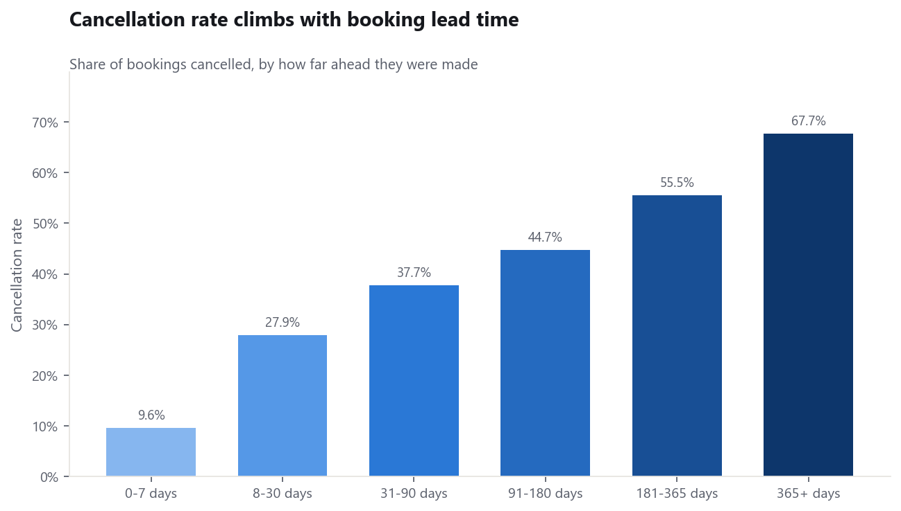
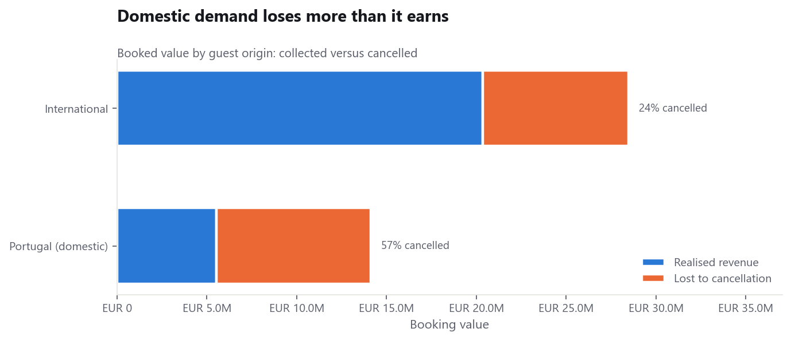

# Hotel Booking Analytics Pipeline

An end-to-end data pipeline over the **Hotel Booking Demand** dataset (Antonio,
Almeida & Nunes, 2019): ~119,000 real bookings from a city hotel and a resort
hotel in Portugal, July 2015 – August 2017.

It downloads the source, validates it, cleans it, engineers analytical features,
loads a star schema into SQLite, runs a library of SQL analyses, trains a
cancellation-risk model, and writes an illustrated report — in one command,
reproducibly, with a data quality gate between each stage.

```
extract ──▶ [validate raw] ──▶ transform ──▶ [validate staged] ──▶ load
                                                                    │
                                                    [validate warehouse]
                                                                    ▼
                                            analyse ──▶ (model) ──▶ report
```

## Quickstart

```bash
pip install -r requirements.txt
python run_pipeline.py
```

That takes about 35 seconds from a cold start and produces:

| Output | What it is |
|---|---|
| `reports/analysis_report.html` | **The report** — designed, self-contained, light and dark themes |
| `reports/analysis_report.md` | The same report as plain text, for diffs and terminals |
| `reports/data_quality.md` | All 43 validation checks, with observed vs expected |
| `reports/figures/*.png` | The charts on their own |
| `reports/tables/*.csv` | Every analysis result as CSV |
| `reports/metrics.json` | Headline numbers, for a dashboard or downstream job |
| `data/warehouse/hotels.db` | The SQLite star schema — query it directly |

Adding `--with-model` also writes `reports/model_metrics.json` and
`data/warehouse/cancellation_model.joblib`.

Start with `reports/analysis_report.html`.

### What it produces





Cancellation risk rises monotonically with how far ahead a booking is made, and
the headline rate turns out to be two very different populations averaged
together. Both charts are generated by the pipeline, in light and dark themes,
and every figure in the report is paired with the table behind it.

## Usage

```bash
python run_pipeline.py                      # full run (~35s)
python run_pipeline.py --strict             # warnings become failures (use in CI)
python run_pipeline.py --force-download     # re-fetch the source CSV
python run_pipeline.py --drop-duplicates    # exclude duplicate rows (see below)
python run_pipeline.py --stage transform    # re-run one stage from disk
python run_pipeline.py --with-model         # also train the model (~5 min)
python run_pipeline.py --query "SELECT * FROM v_monthly_performance LIMIT 10"
```

Scoring a booking, once the model is trained:

```bash
python predict.py --lead-time 300 --country PRT --market-segment Groups
python predict.py --lead-time 3 --country GBR --special-requests 2 --explain
python predict.py --batch bookings.csv --out scored.csv
python predict.py --fields                  # every input and its default
```

Each stage reads the previous stage's artifact off disk, so `--stage` lets you
iterate on the report without re-downloading or re-transforming anything.

## Layout

```
├── run_pipeline.py              CLI entry point
├── src/hotel_pipeline/
│   ├── config.py                all paths and tunables — the only place to edit
│   ├── extract.py               [1] download + immutable raw snapshot
│   ├── transform.py             [2] cleaning rules + feature engineering
│   ├── warehouse.py             [3] star schema + SQLite load
│   ├── analyze.py               [4] runs sql/*.sql, derives headline insights
│   ├── model.py                 [5] trains + calibrates the risk model
│   ├── features.py                  which columns the model may see, and when
│   ├── report.py                [6] charts + HTML/Markdown assembly
│   ├── app.py                       builds the browser scoring app
│   ├── templates/risk_app.html      its page template
│   ├── viz.py                   chart palette, themes and styling
│   ├── validate.py              the expectations engine
│   └── pipeline.py              orchestration + the expectation suites
├── predict.py                   score a booking from the command line
├── sql/                         15 analysis queries, one per file
├── tests/                       66 tests, offline, ~11s
└── data/  reports/  logs/       artifacts (git-ignored)
```

### The layers

**Raw** (`data/raw/`) is immutable. Nothing downstream ever writes back into it,
so any transform bug can be replayed from the original bytes. The download is
atomic — a half-written file never looks complete.

**Staging** (`data/staging/`) is the cleaned, feature-rich flat table as Parquet.
One row per booking, 62 columns. It is also what the model trains on.

**Warehouse** (`data/warehouse/hotels.db`) is the star schema. The point is not
speed at this size — it is a *shared vocabulary*, so an ad-hoc SQL question and
the generated report cannot quietly disagree about what "Direct" means.

## The warehouse

`fact_booking` (119,210 rows) plus eight dimensions: `dim_date`, `dim_hotel`,
`dim_country`, `dim_market_segment`, `dim_distribution_channel`,
`dim_customer_type`, `dim_deposit_type`, `dim_meal`.

Two views save you the joins:

```sql
-- every booking with all labels resolved
SELECT hotel_name, market_segment, AVG(is_canceled) * 100 AS cancel_pct
FROM v_bookings
GROUP BY 1, 2
ORDER BY cancel_pct DESC;

-- pre-aggregated monthly performance per property
SELECT * FROM v_monthly_performance WHERE hotel_name = 'Resort Hotel';
```

`dim_date` is a *dense* calendar spanning the whole period, not just the dates
that appear — that is what lets a time series show a zero-booking day as a zero
instead of omitting it.

## Cleaning decisions

These are judgement calls, not mechanical fixes, so each is stated here and
implemented in `transform.py` with the reasoning inline. Where a row is changed
rather than dropped, the original value is kept alongside it.

| Issue | Rows | Decision |
|---|---|---|
| `children` is null | 4 | Fill with 0 — every other party-size field says 0 on those rows |
| `country` is null | 488 | Label `Unknown`, keep the rows. A missing country is unknown, not absent |
| `agent` / `company` null | 16,340 / 112,593 | Not a zero — zero-filling an ID invents an agent called 0. Kept nullable, plus `has_agent` / `has_company` flags |
| Zero occupants | 180 | **Dropped.** A booking for nobody is a data-entry artifact, not a stay |
| `meal = "Undefined"` | 1,169 | Collapsed into `SC` — both mean self-catering |
| ADR of 5400 and −6.38 | 2 | Winsorised into [0, 1000]; untouched value kept in `adr_raw` |
| Zero-night stays | 645 | **Kept**, flagged `is_zero_night` — real demand signal, but any per-night rate divides by zero |
| Exact duplicate rows | 31,988 | **Kept**, flagged `is_duplicate_row` — see below |

### The duplicates question

About 27% of source rows are field-for-field identical. This is the one decision
in the pipeline that materially moves every headline number, and there is no
objectively correct answer: two guests genuinely can make the same booking, for
the same dates, on the same day, through the same channel — but a 27% duplicate
rate also looks like an export artifact.

The pipeline **keeps them and flags them**, because deleting them would silently
erase real demand and the flag is reversible while a deletion is not. To test the
opposite assumption:

```bash
python run_pipeline.py --drop-duplicates
```

Every figure in the report regenerates under that assumption. If you are making
a decision that turns on these numbers, run it both ways and check whether your
conclusion survives.

## Data quality

Three expectation suites run as gates, 43 checks in total. Results land in
`reports/data_quality.md` and `data_quality.json`.

- **Raw source** — is the source still what we think it is? Schema, row count,
  category domains, value ranges. Fails *before* a transform runs on bad
  assumptions.
- **Staged** — did our own transform do what it claimed? The promised nulls are
  gone, derived columns reconcile with their components, and no booking is
  counted as both realised and lost. This is a regression test on the cleaning
  rules.
- **Warehouse** — referential integrity. Every `v_bookings` join is an INNER
  JOIN, so a row lost between `fact_booking` and the view is exactly an orphaned
  foreign key.

Severity is three-level: `ERROR` stops the run, `WARN` is recorded and carried
forward, `INFO` is a measurement worth trending. A clean run currently passes all
43 with zero warnings, so `--strict` is a usable CI gate.

Checks on known messiness are deliberately written as *rates*, not absolutes. The
raw source contains two absurd ADR values and always will; a plain range check
there would fail on every run and train everyone to ignore it. Instead the check
passes while the problem stays the size it has always been (≤0.1% of rows) and
fires if outliers start multiplying.

## What the data says

Generated fresh each run; the report derives every number rather than hard-coding
it. As of the current source:

- **37.1% of bookings are cancelled** — €16.7M of booked value against €25.9M
  realised. 39% of booked demand evaporates before check-in.
- **Lead time is the dominant signal.** Bookings made 0–7 days out cancel at
  9.6%; those made 365+ days out cancel at 67.7% — a 7× spread, monotonic across
  every bucket in between.
- **Non-refundable deposits cancel *more*, not less** (99.4% vs 28.4% for no
  deposit). Read as selection, not causation: the policy is applied to already
  risky bookings. Still a useful flag, and a bad retention lever.
- **Special requests predict arrival.** No requests → 47.7% cancellation; one or
  more → roughly 22%, falling to 16.8% at three or more. Free, available at
  booking time, trivially usable as a model feature.
- **The two properties are different businesses.** The resort's rate swings from
  ~€48 in November to ~€187 in August; the city hotel holds a far flatter curve.
  Averaging them describes neither.

Caveats are listed at the end of the generated report — read them before acting
on any of the above, particularly the distinction between *lost revenue* (demand
that did not convert) and a cash loss.

## The cancellation model

`--with-model` (or `--stage model`) trains a classifier that predicts the
probability a booking is cancelled, and `predict.py` scores individual bookings
against it. Three decisions shaped it more than the algorithm did.

**Split on time, never at random.** Trained on arrivals before 2017-01-01
(78,590 bookings), tested on everything after (40,620). A model deployed at that
cutoff only knows the outcome of stays that have already happened, so a random
split would train it on bookings whose fate was not yet knowable. Booking
behaviour genuinely drifts across this series, and a random split flatters the
model badly.

**Leakage is enforced in code, not remembered.** `features.py` sorts every
column into three tiers by *when the value becomes known*:

| Tier | Meaning | Example |
|---|---|---|
| `SAFE` | known when the booking is created | `lead_time`, `deposit_type`, `country` |
| `PRE_ARRIVAL` | accumulates before arrival — opt-in, valid only for re-scoring | `booking_changes` |
| `LEAKED` | known only at or after the outcome — never usable | `room_changed`, `reservation_status` |

Ten columns are blocked outright. Two of them are worth naming.

`required_car_parking_spaces` was the one I got wrong first. It looks like an
ordinary booking-time field, so it started in `SAFE` - and then the app returned
a 0.0% prediction for a family booking. The cause: **all 7,409 bookings that
requested parking completed their stay. Zero cancellations, not nearly zero.**
That is perfect separation, which is structure rather than behaviour - the field
is filled in when a space is allocated on arrival. Left in, it earns a
coefficient near -14 and pins any booking with parking to zero risk. There is
now a test that fails on any feature which perfectly separates the target, so
the next one gets caught before it reaches a model rather than after.

`room_changed` is the better-known trap:
bookings where the room changed cancel at ~5% against ~45%, which looks like the
strongest feature in the dataset and is worthless, because rooms are assigned at
check-in and the feature really means *the guest turned up*. `assert_no_leakage`
runs before every training run, and `audit()` proves no staged column went
unclassified. There are tests for both.

**Calibration, not just ranking.** The point of a cancellation model is summing
probabilities into expected arrivals for overbooking, which needs P(cancel) to
be literally true — not merely correctly ordered. So models are selected on
Brier score, not AUC.

### Results on held-out 2017 arrivals

| Model | ROC-AUC | PR-AUC | Brier | Calib. MAE |
|---|---|---|---|---|
| Baseline (base rate) | 0.500 | 0.387 | 0.2379 | — |
| **Logistic regression** | 0.841 | 0.802 | **0.1577** | **0.059** |
| Gradient boosting | **0.848** | **0.808** | 0.1607 | 0.088 |
| Gradient boosting + isotonic | 0.819 | 0.770 | 0.1827 | 0.134 |

These are the numbers *after* removing the leaked parking column. The earlier,
flattering version of this table (0.856 ROC-AUC) was inflated by it.

Two results worth flagging, because both are the opposite of what you would
expect:

- **The linear baseline wins.** Gradient boosting ranks slightly better, but
  logistic regression is better calibrated and scores better on Brier, which is
  the criterion that matters here. The selection is automatic and will pick
  differently if that stops being true.
- **Isotonic calibration made things worse.** It is fitted on the training
  distribution, and the training period has a lower cancellation rate (36.2%)
  than the test period (38.7%), so it bakes in the wrong prior.

### The honest limitation

The model **under-predicts**: it averages 32.9% against an actual 38.7%, close to
six points low across most of the range. That is distribution shift, not a bug,
and it has a practical consequence — the ranking is reliable, but an absolute
forecast needs correcting for the current base rate before you sum it into
expected arrivals. Retraining on a rolling window would be the real fix.

### Scoring

```bash
$ python predict.py --lead-time 300 --country PRT --market-segment Groups

  Cancellation risk   79.5%   [High]
  ###################################.........
  2.05x the 38.7% base rate for this period
```

Every field you omit falls back to the dataset's **modal** booking — which is
itself high-risk (Portuguese, Online TA, 90-day lead). `--explain` lists exactly
which fields were defaulted, so a scary number is never mistaken for one driven
by your own inputs.

The model also writes a score for every booking back to the warehouse as
`fact_booking_scored`, joined into a `v_booking_risk` view:

```sql
SELECT risk_band, COUNT(*), ROUND(AVG(is_canceled) * 100, 1) AS actual_pct
FROM v_booking_risk GROUP BY risk_band;
```

### The browser scoring app

Training also builds `reports/risk_app.html` — a self-contained page that scores
a booking as you type, with no server and no Python.

That works because the selected model is a logistic regression, which is only a
scaler, a one-hot table and a dot product. `export_for_web()` writes it out as
8KB of JSON and the page runs the real model client-side. The export is not
taken on trust: it re-scores 400 real bookings using only the exported numbers
and **refuses to write the file** if it disagrees with scikit-learn by more than
1e-9 (observed drift: 2.2e-16). The page is rebuilt from the template on every
training run, so the app and the model cannot drift apart.

Because it is linear, the page can also show *why* — each input's actual push on
the log-odds, which is the true decomposition rather than a feature-importance
proxy.

```bash
python run_pipeline.py --stage model     # trains, exports, builds the app
start reports/risk_app.html              # macOS/Linux: open
```

## Adding an analysis

Drop a `.sql` file into `sql/`. It is picked up automatically, exported to
`reports/tables/<name>.csv`, and available to the report — no code change:

```sql
-- sql/my_question.sql
SELECT customer_type, AVG(total_nights) AS avg_nights
FROM v_bookings
GROUP BY customer_type;
```

The queries live in files rather than in Python strings so they are readable
without running anything and paste straight into any SQL client.

To chart it, add a function to `report.py` and one entry to the `CHARTS` list.

## Testing

```bash
python -m unittest discover -s tests -v     # no install needed
pytest tests -v                             # if pytest is available
```

66 tests, fully offline — each builds a small frame with every quirk of the real
source baked in. They pin the *cleaning decisions* and the *leakage rules*, which
are the two parts of a pipeline that silently drift.

## Charts

Colour is assigned by the job it does, never by series order: a sequential blue
ramp for magnitude on an ordered scale, a fixed categorical order for distinct
series, and emphasis (one hue plus grey) when a single bar carries the point. The
categorical order is validated for colour-vision deficiency on adjacent pairs.
Every figure in the report is paired with its underlying table — that is the
table view that keeps it readable when the colour encoding fails.

## Source

[TidyTuesday mirror](https://github.com/rfordatascience/tidytuesday/tree/master/data/2020/2020-02-11)
of *Hotel booking demand datasets*, Antonio, Almeida & Nunes, **Data in Brief**
22 (2019), 41–49. Anonymised real hotel data, published under CC0.
